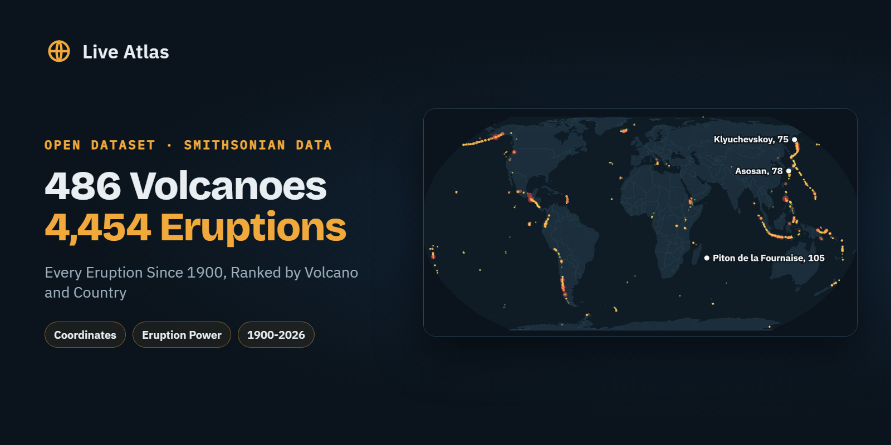

# Most Active Volcanoes Since 1900



**486 Volcanoes and Their 4,454 Eruptions Since 1900, Ranked, With VEI and Maps**


Every volcano that has started at least one eruption since January 1900, ranked by how many times it erupted, with its type, coordinates, elevation and strongest eruption. Plus a country summary and a year-by-year count from 1900 to 2026.

The most active volcano of the period isn't in Hawaii, Italy or Indonesia. It's [Piton de la Fournaise](https://www.liveatlas.earth/volcanoes/piton-de-la-fournaise/) on Réunion Island, an overseas department of France in the Indian Ocean, with 105 eruptions since 1900. That's almost one a year, and well ahead of Asosan in Japan (78) and Klyuchevskoy in Kamchatka (75).

## What's Inside

**volcanoes_erupted_since_1900.csv** (486 rows). One row per volcano, ranked by number of eruptions since 1900. Smithsonian volcano number, name, country, type, latitude, longitude, elevation, eruption count, strongest eruption since 1900 and on record (VEI), last eruption year, and a link to the volcano's page on Live Atlas with its full eruption timeline.

**volcanic_activity_by_country_since_1900.csv** (58 rows). Volcanoes that erupted, total eruptions, strongest eruption and the most active volcano, per country.

**eruptions_per_year_since_1900.csv** (127 rows). Eruptions started each year from 1900 to 2026, the number of volcanoes involved, the strongest VEI of the year and the count of VEI 4 or larger.

## Columns

### volcanoes_erupted_since_1900.csv

Volcanoes with at least one eruption starting in 1900 or later, ranked by number of eruptions, with a link to each volcano's Live Atlas page.

| Column | Type | Description |
|---|---|---|
| rank | integer | Rank by number of eruptions since 1900 (ties share the same rank) |
| gvp_volcano_number | id | Smithsonian Global Volcanism Program volcano number |
| volcano | string | Volcano name |
| country | country | Primary country (Smithsonian) |
| volcano_type | string | Primary volcano type (Smithsonian) |
| latitude | latitude | Latitude, decimal degrees (WGS 84) |
| longitude | longitude | Longitude, decimal degrees (WGS 84) |
| elevation_m | integer | Summit elevation in metres |
| eruptions_since_1900 | integer | Eruptions starting in 1900 or later |
| max_vei_since_1900 | integer | Highest Volcanic Explosivity Index (0-8) of those eruptions, empty if unknown |
| max_vei_on_record | integer | Highest VEI on record for the volcano |
| last_eruption_year | integer | Start year of the most recent eruption |
| liveatlas_url | url | Volcano page on Live Atlas (map, eruption timeline, live activity) |

### volcanic_activity_by_country_since_1900.csv

Volcanic activity since 1900 per country, with the most active volcano.

| Column | Type | Description |
|---|---|---|
| country | country | Primary country (Smithsonian) |
| volcanoes_erupted_since_1900 | integer | Volcanoes with at least one eruption since 1900 |
| eruptions_since_1900 | integer | Total eruptions started since 1900 |
| max_vei_since_1900 | integer | Highest VEI of those eruptions |
| most_active_volcano | string | Volcano with the most eruptions since 1900 |
| most_active_volcano_eruptions | integer | Its number of eruptions since 1900 |
| most_active_volcano_url | url | Its page on Live Atlas |

### eruptions_per_year_since_1900.csv

Eruptions started each year, 1900 to 2026 (2026 partial, to 12 October).

| Column | Type | Description |
|---|---|---|
| year | integer | Calendar year |
| eruptions_started | integer | Eruptions that started that year |
| volcanoes_with_new_eruption | integer | Distinct volcanoes with an eruption starting that year |
| max_vei | integer | Highest VEI among those eruptions, empty if unknown |
| eruptions_vei_4_or_more | integer | Eruptions of VEI 4 or larger |

## Load It

```python
from datasets import load_dataset

volcanoes = load_dataset("liveatlasearth/most-active-volcanoes-since-1900", "volcanoes", split="train").to_pandas()
```

## Key Findings

| | |
|---|---|
| Volcanoes with an eruption since 1900 | 486, in 58 countries and territories |
| Eruptions started, 1900 to October 2026 | 4,454, about 35 a year |
| Most active volcano | Piton de la Fournaise, France (Réunion), 105 |
| Most active country | Indonesia, 69 volcanoes and 825 eruptions |
| Busiest year | 2004, 54 eruptions started |
| VEI 6 eruptions | 3, Santa María 1902, Novarupta 1912, Pinatubo 1991 |

**Indonesia or the USA?** Count only volcanoes that erupted since 1900 and Indonesia leads (69), ahead of the USA (58), Japan (51) and Russia (41). Count every volcano active since the end of the last ice age and the USA comes first with 165, a ranking we break down on [the country with the most volcanoes](https://www.liveatlas.earth/rankings/country-with-the-most-volcanoes/).

## Caveats

- **One eruption, one row, whatever its length.** The Smithsonian counts an eruption once, at its start, even if it lasts decades. That's why Stromboli or Mount Yasur, in near-constant activity, rank lower than volcanoes with many short eruptions.
- **Confirmed and uncertain eruptions are both counted**, as in the Smithsonian database.
- **Early decades are incomplete.** Remote eruptions in the early 1900s often went unrecorded, so part of the rise over time reflects better monitoring.
- **2026 is a partial year**, up to the snapshot of 12 October 2026.
- **VEI** (Volcanic Explosivity Index) runs from 0 (gentle lava flows) to 8 (supereruption). It is empty when the Smithsonian gives none.

## Source and Method

Built from the Smithsonian Global Volcanism Program, Volcanoes of the World v5.4.0 (7 August 2026), with the eruption start years and VEI of each volcano. An eruption counts when it starts in 1900 or later. Country is the Smithsonian's primary country for the volcano.

Please cite the original database as well. Global Volcanism Program (2026). Volcanoes of the World (v. 5.4.0; 7 Aug 2026). Smithsonian Institution. https://volcano.si.edu/

## About

Compiled by Nathan Ridge for [Live Atlas](https://www.liveatlas.earth/), a free live map of earthquakes, volcanoes, cyclones and wildfires. Each volcano in the table links to its own page, all of them listed by country on [Volcanoes of the World](https://www.liveatlas.earth/volcanoes/). You can also check which [volcanoes are erupting right now](https://www.liveatlas.earth/volcanoes-erupting-now/), and the [major eruptions in history](https://www.liveatlas.earth/eruptions/) are ranked by power and death toll.

## Checked Against The Source

On 30 October 2026 the eruption counts were recomputed from the Smithsonian GVP web services, and all 486 volcanoes and 4,454 eruptions match the dataset.

## Also Available

- The same dataset on [Hugging Face](https://huggingface.co/datasets/liveatlasearth/most-active-volcanoes-since-1900), ready for the `datasets` library
- The same dataset on [Kaggle](https://www.kaggle.com/datasets/liveatlasearth/most-active-volcanoes-since-1900), with a starter notebook
- [Was There an Earthquake Near Me?](https://huggingface.co/spaces/liveatlasearth/was-there-an-earthquake-near-me), a live earthquake finder on Hugging Face Spaces

---

**Part of [Natural Hazards Datasets](https://github.com/liveatlasearth/natural-hazards-datasets)**, open data on earthquakes, volcanoes, storms, fires and space weather. Data by [Live Atlas](https://www.liveatlas.earth/), the free live map of the planet's hazards.
